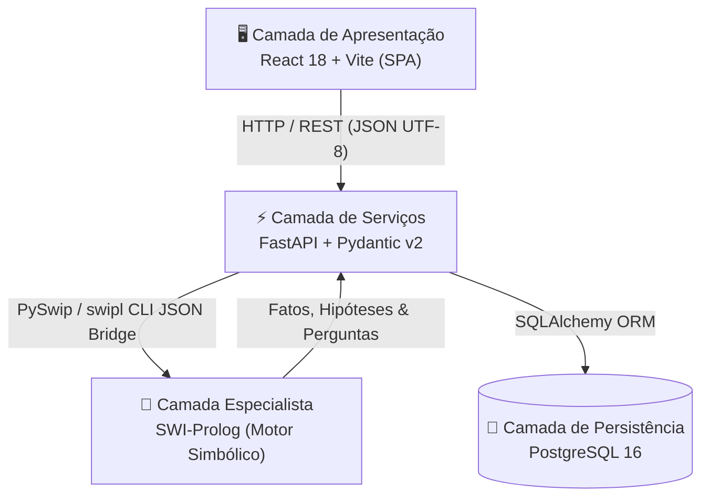

# 🖥️ TechExpert — Sistema Especialista para Diagnóstico de Problemas Computacionais

<p align="center">
  
  
  
  
  
  
</p>

---

## 📌 Sobre o Projeto

O **TechExpert** é um sistema especialista fundamentado em **Inteligência Artificial Simbólica** e lógica de predicados de primeira ordem, concebido para diagnosticar problemas complexos de hardware, conectividade e desempenho em computadores pessoais e corporativos.

Diferente de modelos puramente estatísticos ou caixas-pretas (*black-box*), o TechExpert combina o motor declarativo **SWI-Prolog** com uma pilha moderna web (**FastAPI** + **React** + **PostgreSQL**). Cada diagnóstico gerado é acompanhado de sua **árvore de raciocínio dedutivo** (premissas satisfeitas e regras ativadas), um roteiro ordenado de recomendações e alertas de segurança técnica para intervenções de risco.

> [!NOTE]
> Baseado nas especificações técnicas do documento de engenharia de software *TechExpert — Sistema Especialista para Diagnóstico de Problemas Computacionais (Versão 1.0)*.

---

## 🎯 Principais Funcionalidades

- 🧠 **Motor Dedutivo Multidomínio**: Diagnóstico simultâneo (*multi-hypothesis inference*) em 7 domínios computacionais (Inicialização, Memória RAM, Armazenamento, Energia, Rede Local/Gateway, DNS/Internet e Desempenho Térmico/Processamento).
- 🔍 **Explicabilidade Lógica Completa**: Transparência total com indicação formal do código da regra aplicada (ex.: `R01_VIDEO_OFF`), descrição da causa raiz e premissas que fundamentaram a inferência.
- ⚡ **Detecção de Contradições em Tempo Real**: Alertas imediatos caso o operador selecione sintomas incompatíveis (ex.: `pc_nao_liga` juntamente com `lentidao_geral`).
- ❓ **Perguntas Complementares Inteligentes (RF09)**: Quando uma hipótese preliminar é identificada, o motor sugere dinamicamente sintomas adicionais para refinar a investigação.
- 🛠️ **Recomendações com Nível de Risco Técnico**: Roteiro de passos de mitigação ordenados, sinalizando claramente quando o procedimento exige ferramentas ESD ou a intervenção de um técnico qualificado.
- 📜 **Auditoria e Histórico Completo de Investigações**: Registro relacional completo de consultas, sintomas informados, hipóteses inferidas e datas para suporte e governança.
- 🛡️ **Segurança Rigorosa**: Proteção nativa contra *Prolog Injection* via validação de vocabulário controlado (regex + whitelist) e total isolamento de credenciais (nenhuma senha é solicitada ou manipulada).

---

## 🏗️ Arquitetura do Sistema

O TechExpert é estruturado em **4 camadas desacopladas**:



### Camadas de Destaque
1. **Camada Especialista (`prolog/`)**:
   - `knowledge_base.pl`: Orquestrador de inferência multi-hipótese via `findall/3`, geração de perguntas e consistência lógica.
   - `rules/`: Módulos de regras separadas por contexto técnico (`hardware.pl`, `network.pl`, `performance.pl`).
   - `facts/symptoms.pl`: Catálogo normatizado de 36 sintomas, 19 causas, recomendações e regras de contradição.
2. **Camada de Backend (`backend/`)**:
   - Endpoints assíncronos FastAPI, orquestrando validação, persistência e comunicação segura com o Prolog.
   - **Bridge Híbrido Resiliente**: Suporte a PySwip nativo com fallback automático para execução via CLI `swipl` e decodificação JSON estruturada.
3. **Camada de Interface (`frontend/`)**:
   - Interface com abas para diagnóstico em tempo real, painel de refinamento interativo, histórico paginado e visualizador do catálogo de conhecimento.

---

## 📂 Estrutura do Repositório

```text
TechExpert/
├── 📁 backend/                      # API REST FastAPI & Persistência
│   ├── 📁 app/
│   │   ├── 📁 database/             # Modelos SQLAlchemy e Seeder
│   │   ├── 📁 routes/               # Rotas REST (/api/consultas, /api/diagnosticos)
│   │   ├── 📁 schemas/              # Contratos Pydantic v2 com validação estrita
│   │   ├── 📁 services/             # PrologService com fallback híbrido
│   │   └── main.py                  # Entrypoint do FastAPI e handlers globais
│   ├── 📁 tests/                    # Suíte com 26 testes de integração pytest
│   ├── Dockerfile
│   └── requirements.txt
├── 📁 prolog/                       # Base de Conhecimento e Motor Simbólico
│   ├── 📁 facts/
│   │   └── symptoms.pl              # Fatos: 36 sintomas, causas, recomendações
│   ├── 📁 rules/
│   │   ├── hardware.pl              # Regras R01 a R11 (Hardware & Energia)
│   │   ├── network.pl               # Regras R12 a R15 (Rede & Internet)
│   │   └── performance.pl           # Regras R16 a R19 (Desempenho & Térmico)
│   ├── 📁 tests/
│   │   └── diagnostic_tests.pl      # 28 testes unitários formais plunit
│   └── knowledge_base.pl            # Motor de inferência e pipeline JSON
├── 📁 frontend/                     # Interface do Usuário React + Vite
│   ├── 📁 src/
│   │   ├── 📁 components/           # Seletores, Painéis de Diagnóstico e Perguntas
│   │   ├── 📁 pages/                # Investigação, Histórico e Base de Conhecimento
│   │   ├── 📁 services/             # Cliente HTTP desacoplado com Axios
│   │   └── 📁 utils/                # Filtros, ordenação e helpers
│   ├── 📁 tests/                    # 12 testes unitários (node:test)
│   ├── Dockerfile
│   └── package.json
├── 📁 docs/                         # Documentação Técnica e Especificações
│   ├── architecture.md              # Diagramas, DDL, fluxo de inferência e segurança
│   ├── knowledge_base.md            # Mapeamento completo dos 7 domínios e regras
│   ├── requirements.md              # Requisitos funcionais (RF01-10) e não funcionais
│   └── ROTEIRO_DESENVOLVIMENTO.md   # Plano de entrega e fases de execução
├── docker-compose.yml               # Orquestração de todos os containers
└── README.md
```

---

## 🚀 Guia de Início Rápido

### Pré-requisitos
- **Git**
- **Docker** e **Docker Compose** (Recomendado)  
  *OU para execução local sem Docker:*
  - **SWI-Prolog** >= 9.0 (`swipl` disponível no PATH)
  - **Python** >= 3.11
  - **Node.js** >= 18 e npm

---

### Opção 1: Executando com Docker Compose (Recomendado)

Suba toda a infraestrutura (PostgreSQL, Backend FastAPI e Frontend React) com um único comando:

```bash
docker compose up --build -d
```

- **Frontend (Interface do Usuário):** [http://localhost:5173](http://localhost:5173)
- **API Backend:** [http://localhost:8000](http://localhost:8000)
- **Documentação Interativa (Swagger/OpenAPI):** [http://localhost:8000/docs](http://localhost:8000/docs)
- **Healthcheck da API:** [http://localhost:8000/health](http://localhost:8000/health)

---

### Opção 2: Executando Localmente

#### 1. Configurar o Banco de Dados e Backend
```bash
# Entre no diretório do backend
cd backend

# Crie e ative um ambiente virtual
python -m venv venv
# No Windows:
venv\Scripts\activate
# No Linux/macOS:
source venv/bin/activate

# Instale as dependências
pip install -r requirements.txt

# Inicialize as tabelas e o seed do catálogo no banco (SQLite local ou PostgreSQL)
python -m app.database.seed

# Inicie o servidor FastAPI
uvicorn app.main:app --reload --port 8000
```

#### 2. Configurar o Frontend
Em outro terminal:
```bash
cd frontend

# Instale os pacotes
npm install

# Inicie o servidor de desenvolvimento
npm run dev
```
Acesse a aplicação em `http://localhost:5173`.

---

## 🧪 Suíte de Testes e Validação de Qualidade

O TechExpert possui cobertura abrangente em todos os níveis da pilha:

| Camada | Ferramenta | Testes | Como Executar |
| :--- | :--- | :---: | :--- |
| **Motor Prolog** | `plunit` | **28** | `swipl -g run_tests -t halt prolog/tests/diagnostic_tests.pl` |
| **Backend REST** | `pytest` | **26** | `python -m pytest backend/tests -v` |
| **Frontend Web** | `node:test` | **12** | `npm --prefix frontend run test:api` |
| **Total** | — | **66** | *100% dos testes aprovados* |

### Exemplo de execução dos testes de lógica do Prolog:
```bash
swipl -g run_tests -t halt prolog/tests/diagnostic_tests.pl
# % PL-Unit: diagnostico_expert ............................ done
# % All 28 tests passed
```

---

## 🔒 Segurança e Limitações Operacionais

Conforme estipulado na **Seção 17** das diretrizes de engenharia do sistema:

1. **Separação de Papéis e Credenciais**: O sistema nunca solicita nem armazena senhas de rede, chaves de criptografia ou credenciais de usuários.
2. **Defesa em Profundidade contra Injeção**: Todo identificador de sintoma submetido à API é rigorosamente validado contra a expressão regular `^[a-z][a-z0-9_]{1,63}$` e confrontado contra a lista estrita dos 36 sintomas válidos antes de qualquer interpolação lógica.
3. **Isenção de Responsabilidade e Alertas de Risco**: Todos os diagnósticos são expressamente classificados como **hipóteses técnicas prováveis**. O sistema emite avisos de segurança obrigatórios para intervenções envolvendo tensão de rede elétrica, desmontagem de fontes de alimentação (risco de choque por capacitores de alta voltagem) ou manuseio de circuitos suscetíveis a descargas eletrostáticas (ESD).

---

## 🗺️ Roadmap e Evolução

- [x] **Fase 1**: Modelagem do Conhecimento, Arquitetura e Engenharia de Requisitos.
- [x] **Fase 2**: Implementação do Motor de Inferência e Regras Formais em SWI-Prolog.
- [x] **Fase 3**: Backend FastAPI, Persistência Relacional e Bridge Híbrido PySwip/CLI.
- [x] **Fase 4**: Interface Web Completa em React com Explicabilidade e Histórico.
- [ ] **Fase 5**: Avaliação Empírica de Acurácia (Precisão/Revocação em 10 casos de referência).
- [ ] **Evolução Neuro-Simbólica**: Integração com Modelos de Linguagem (LLMs) para recepção de queixas do usuário em linguagem natural livre e conversão em predicados controlados.

---

## 👥 Autores & Contribuição

Desenvolvido como projeto de referência para aplicação prática de **Sistemas Especialistas e Inteligência Artificial Simbólica** na área de diagnóstico e manutenção de infraestrutura de TI.

Dúvidas, sugestões e melhorias são bem-vindas via Pull Requests ou Issues!

---
<p align="center">
  <b>TechExpert</b> — <i>Diagnóstico computacional confiável, explicável e determinístico.</i>
</p>
