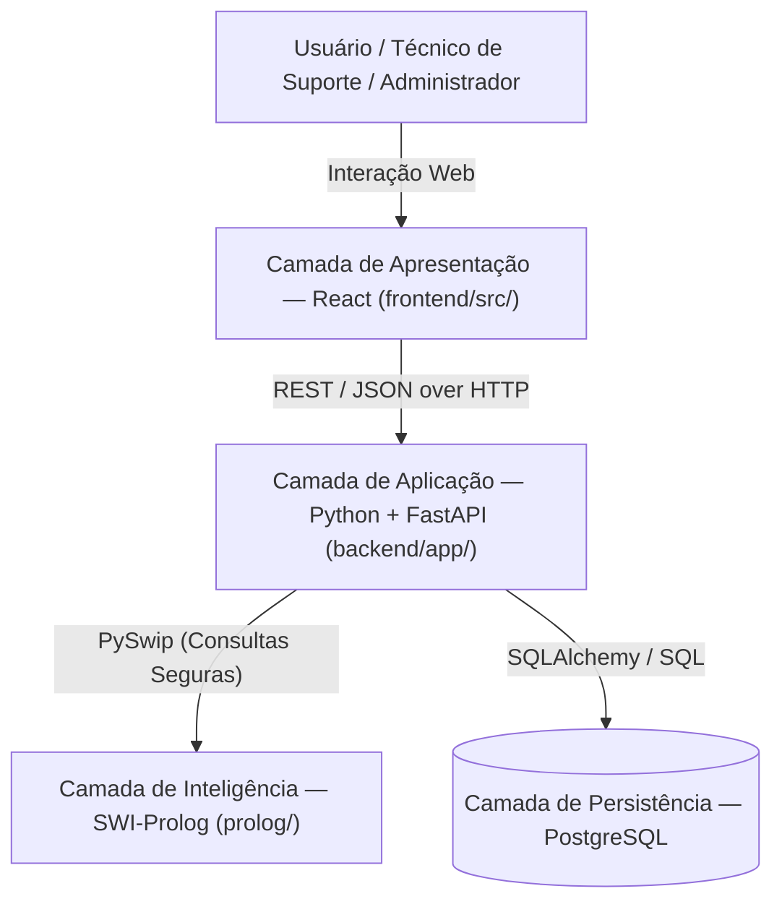
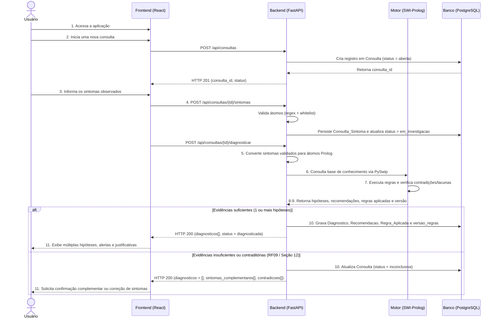
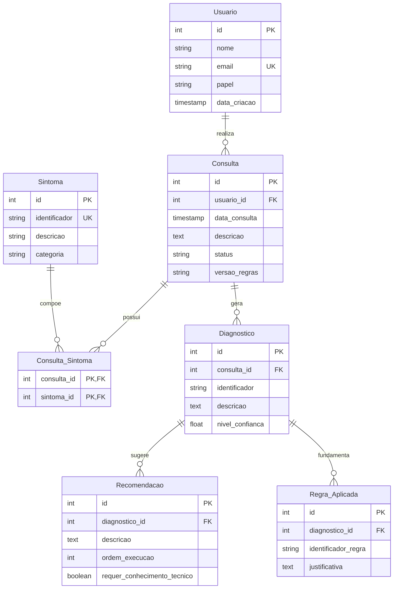

# Arquitetura do Sistema — TechExpert

> **Versão:** `1.0.0`  
> **Documento de referência:** `TechExpert — Sistema Especialista para Diagnóstico de Problemas Computacionais.pdf` (Seções 9, 10, 11, 12, 13, 14, 15 e 17)  
> **Documentos complementares:** [knowledge_base.md](./knowledge_base.md) | [requirements.md](./requirements.md)  
> **Status:** Documentação arquitetural da v1.0 concluída (Passo 1.4)

---

## 1. Visão Geral e Camadas Arquiteturais (Seção 10.1)

O **TechExpert** adota uma **arquitetura em 4 camadas**, garantindo modularidade (`RNF04`), facilidade de manutenção das regras (`RNF03`), explicabilidade (`RNF06`) e separação clara entre interface de usuário, orquestração de casos de uso, raciocínio simbólico e persistência relacional.



### Responsabilidades e Fronteiras de Isolamento (`RNF04`)

| Camada | Tecnologia | Diretório Principal | Responsabilidades | Restrições de Fronteira |
| :--- | :--- | :--- | :--- | :--- |
| **Apresentação** | React | `frontend/src/` | Renderização de formulários de sintomas por categoria, fluxo interativo de perguntas complementares (`RF09`), exibição de múltiplas hipóteses técnicas, recomendações ordenadas, alertas de risco técnico, painel de explicabilidade (`RF05`) e histórico (`RF07`). | Não contém lógica de inferência; comunica-se exclusivamente via HTTP/JSON com a camada de aplicação (`services/`). |
| **Aplicação** | Python + FastAPI + PySwip | `backend/app/` | Recepção de requisições REST, validação estrita de entradas com Pydantic e whitelist (`RNF05`), gestão do ciclo de vida das consultas, tradução segura para átomos Prolog, orquestração de persistência no PostgreSQL e controle de acesso administrativo (`RF08`). | Não implementa regras de diagnóstico em `if/else` Python; delega toda inferência ao motor SWI-Prolog. |
| **Inteligência** | SWI-Prolog | `prolog/` | Representação declarativa do conhecimento (fatos e regras por domínio), inferência lógica por unificação e *backtracking*, produção de múltiplas hipóteses (`findall/3`), explicabilidade (`regra_id` + justificativa), detecção de contradições e sugestão de sintomas complementares. | Não acessa rede, banco de dados nem sistema operacional do usuário; opera apenas sobre átomos validados. |
| **Persistência** | PostgreSQL | `backend/app/database/` | Armazenamento histórico de usuários, consultas, sintomas informados, hipóteses diagnósticas, recomendações ordenadas, regras aplicadas e versão da base utilizada em cada consulta. | Não armazena a lógica de inferência (mantida em arquivos `.pl`, conforme Seção 9.4 do PDF). |

---

## 2. Fluxo de Funcionamento em 11 Etapas (Seção 10.2)

O ciclo principal de atendimento de uma investigação segue as 11 etapas previstas na Seção 10.2 da especificação, complementado pelos desvios controlados para **evidências contraditórias** e **consulta complementar (`RF09`)**.



### Detalhamento das 11 Etapas
1. **Acesso à aplicação:** o usuário carrega a interface web React (`App.jsx`), que obtém o catálogo de sintomas e categorias via `GET /api/diagnosticos` (ou endpoint dedicado de catálogo).
2. **Início da consulta (`RF01`):** o usuário cria uma nova investigação (`POST /api/consultas`), gravada com `status = aberta`.
3. **Seleção de sintomas (`RF02`):** o usuário marca os sintomas observados agrupados por domínio (sem solicitação de senhas ou dados confidenciais).
4. **Envio ao backend:** o frontend envia os identificadores selecionados para `POST /api/consultas/{id}/sintomas` e dispara a avaliação via `POST /api/consultas/{id}/diagnosticar`.
5. **Validação e transformação segura:** o backend valida os identificadores contra o padrão `^[a-z][a-z0-9_]{1,63}$` e a whitelist oficial, evitando qualquer concatenação insegura no Prolog (`RNF05`).
6. **Consulta à base de conhecimento:** o `prolog_service.py` aciona a base carregada em memória via `PySwip`.
7. **Execução de regras:** o SWI-Prolog executa verificação de contradições e avalia todas as regras em `hardware.pl`, `network.pl` e `performance.pl`.
8. **Identificação de causas e recomendações:** todas as hipóteses compatíveis (`RF06`), suas recomendações ordenadas (`RF04`) e as regras/evidências justificadoras (`RF05`) são reunidas via `findall/3`. Se nenhuma regra disparar, calculam-se os sintomas complementares (`RF09`).
9. **Retorno ao backend:** o serviço Python converte os termos Prolog para objetos tipados Pydantic.
10. **Registro histórico (`RF07`):** o backend persiste `Diagnostico`, `Recomendacao`, `Regra_Aplicada` e a `versao_regras` na tabela `Consulta`, devolvendo o JSON padronizado ao frontend.
11. **Visualização explicável:** o React exibe os resultados rotulados explicitamente como **hipóteses técnicas**, com alertas de conhecimento técnico e painel de explicabilidade. Ao finalizar, o usuário pode encerrar a consulta (`RF10`).

---

## 3. Contrato de Integração Backend ↔ Motor SWI-Prolog

O ponto de entrada do motor simbólico é [`prolog/knowledge_base.pl`](../prolog/knowledge_base.pl), que importa [`prolog/facts/symptoms.pl`](../prolog/facts/symptoms.pl) e os três módulos de domínio em `prolog/rules/` (`hardware.pl`, `network.pl`, `performance.pl`).

### 3.1. Predicados Estruturais da Base de Fatos (`prolog/facts/symptoms.pl`)

| Predicado | Assinatura | Finalidade |
| :--- | :--- | :--- |
| `versao_base_regras/1` | `versao_base_regras(Versao)` | Declara a versão ativa da base (ex.: `'1.0.0'`) para auditoria (Seção 17). |
| `sintoma/3` | `sintoma(Identificador, Descricao, Categoria)` | Catálogo mestre dos 36 átomos de sintomas válidos e suas categorias. |
| `pergunta_complementar/2` | `pergunta_complementar(Identificador, Pergunta)` | Texto interrogativo usado quando o sintoma é sugerido em consulta complementar (`RF09`). |
| `causa/3` | `causa(IdentificadorCausa, Descricao, Categoria)` | Metadados descritivos de cada uma das 19 causas/hipóteses diagnósticas. |
| `recomendacao/4` | `recomendacao(IdentificadorCausa, Ordem, Descricao, RequerTecnico)` | Passos ordenados de resolução (`Ordem` inteiro) e booleano (`true`/`false`) indicando risco técnico. |
| `contraditorio/2` | `contraditorio(SintomaA, SintomaB)` | Pares de sintomas mutuamente exclusivos (Seção 12). |

### 3.2. Predicados de Regras e Inferência (`prolog/rules/*.pl` e `prolog/knowledge_base.pl`)

1. **Compatibilidade com o exemplo da Seção 12 (`diagnostico/3`):**
   - Mantém o predicado `diagnostico(Causa, Sintomas, SolucaoPrincipal)` para consultas simples diretas em Prolog e validação conceitual da documentação.
2. **Predicado completo com explicabilidade (`regra_diagnostico/6`):**
   - Definido nos módulos `hardware.pl`, `network.pl` e `performance.pl`:
   ```prolog
   regra_diagnostico(
       RegraId,
       CausaId,
       SintomasInformados,
       EvidenciasRequeridas,
       RecomendacaoPrincipal,
       Justificativa
   )
   ```
3. **Predicado orquestrador chamado pelo `prolog_service.py` (`avaliar_sintomas/6`):**
   ```prolog
   avaliar_sintomas(
       SintomasInformados,
       VersaoBase,
       Contradicoes,
       Hipoteses,
       SintomasComplementares,
       StatusInferencia
   )
   ```
   - `VersaoBase`: átomo/string da versão vigente (ex.: `'1.0.0'`).
   - `Contradicoes`: lista de pares `contradicao(SintomaA, SintomaB)` presentes simultaneamente em `SintomasInformados`.
   - `Hipoteses`: lista coletada com `findall/3` contendo termos estruturados com `CausaId`, `DescricaoCausa`, `RegraId`, `EvidenciasUsadas`, `Justificativa` e lista ordenada de `Recomendacoes` (`recomendacao(Ordem, Texto, RequerTecnico)`). Se `Contradicoes \= []`, retorna `[]`.
   - `SintomasComplementares`: se `Hipoteses = []` e `Contradicoes = []`, coleta os átomos faltantes das regras parcialmente satisfeitas (com sua `pergunta_complementar/2`) sem duplicar sintomas já informados ou contraditórios.
   - `StatusInferencia`: um dos átomos `diagnosticada`, `insuficiente` ou `contraditoria`.

---

## 4. Modelo de Dados Relacional — PostgreSQL (Seção 13)

O esquema relacional implementa integralmente as **7 entidades** previstas na Seção 13 da especificação, acrescidas apenas dos atributos de suporte exigidos pelas seções de segurança e requisitos (`versao_regras` para auditoria da Seção 17, `papel` para controle administrativo `RF08` e `requer_conhecimento_tecnico` para alertas de segurança).



### Especificação das Tabelas (`backend/app/database/models.py`)

| Tabela | Coluna | Tipo / Constraint | Descrição |
| :--- | :--- | :--- | :--- |
| **`usuario`** | `id` | `SERIAL PRIMARY KEY` | Identificador único do usuário. |
| | `nome` | `VARCHAR(120) NOT NULL` | Nome de exibição do usuário. |
| | `email` | `VARCHAR(180) UNIQUE NOT NULL` | E-mail de identificação (sem armazenar senhas de terceiros ou dados confidenciais). |
| | `papel` | `VARCHAR(20) NOT NULL DEFAULT 'usuario'` | Perfil de acesso (`usuario` ou `admin` para `RF08`). |
| | `data_criacao` | `TIMESTAMPTZ NOT NULL DEFAULT NOW()` | Data/hora de criação do registro. |
| **`consulta`** | `id` | `SERIAL PRIMARY KEY` | Identificador único da investigação. |
| | `usuario_id` | `INTEGER FK -> usuario(id) NULLABLE` | Usuário solicitante (permite associação opcional em uso anônimo/sessão ou usuário autenticado). |
| | `data_consulta` | `TIMESTAMPTZ NOT NULL DEFAULT NOW()` | Data/hora de abertura da consulta. |
| | `descricao` | `TEXT NULL` | Relato inicial opcional informado pelo usuário. |
| | `status` | `VARCHAR(30) NOT NULL DEFAULT 'aberta'` | Estado atual (`aberta`, `em_investigacao`, `diagnosticada`, `inconclusiva`, `encerrada`). |
| | `versao_regras` | `VARCHAR(20) NULL` | Versão da base Prolog aplicada no diagnóstico (Seção 17). |
| **`sintoma`** | `id` | `SERIAL PRIMARY KEY` | Identificador numérico do sintoma. |
| | `identificador` | `VARCHAR(64) UNIQUE NOT NULL` | Átomo Prolog padronizado (ex.: `sem_imagem`). |
| | `descricao` | `VARCHAR(255) NOT NULL` | Descrição legível exibida no frontend. |
| | `categoria` | `VARCHAR(40) NOT NULL` | Categoria de agrupamento (`inicializacao`, `video`, etc.). |
| **`consulta_sintoma`** | `consulta_id` | `INTEGER PK, FK -> consulta(id) ON DELETE CASCADE` | Chave estrangeira para a consulta. |
| | `sintoma_id` | `INTEGER PK, FK -> sintoma(id) ON DELETE RESTRICT` | Chave estrangeira para o sintoma observado. |
| **`diagnostico`** | `id` | `SERIAL PRIMARY KEY` | Identificador único da hipótese registrada. |
| | `consulta_id` | `INTEGER NOT NULL FK -> consulta(id) ON DELETE CASCADE` | Consulta à qual a hipótese pertence. |
| | `identificador` | `VARCHAR(64) NOT NULL` | Átomo da causa identificada (ex.: `possivel_falha_ram`). |
| | `descricao` | `TEXT NOT NULL` | Descrição amigável da hipótese técnica. |
| | `nivel_confianca` | `NUMERIC(4,3) NULL` | Reservado para uso futuro quando houver modelo de pontuação validado (Seção 13 e Seção 19). |
| **`recomendacao`** | `id` | `SERIAL PRIMARY KEY` | Identificador da recomendação. |
| | `diagnostico_id` | `INTEGER NOT NULL FK -> diagnostico(id) ON DELETE CASCADE` | Diagnóstico associado. |
| | `descricao` | `TEXT NOT NULL` | Procedimento recomendado ao usuário. |
| | `ordem_execucao` | `INTEGER NOT NULL` | Ordem sequencial de execução (`1, 2, 3...`). |
| | `requer_conhecimento_tecnico` | `BOOLEAN NOT NULL DEFAULT FALSE` | Indica necessidade de alerta de risco técnico (Seção 17). |
| **`regra_aplicada`** | `id` | `SERIAL PRIMARY KEY` | Identificador do registro de explicabilidade. |
| | `diagnostico_id` | `INTEGER NOT NULL FK -> diagnostico(id) ON DELETE CASCADE` | Diagnóstico fundamentado pela regra. |
| | `identificador_regra` | `VARCHAR(64) NOT NULL` | ID da regra Prolog acionada (ex.: `regra_video_02`). |
| | `justificativa` | `TEXT NOT NULL` | Explicação detalhada relacionando evidências e conclusão. |

### Índices Recomendados
- `idx_consulta_usuario_data` em `consulta(usuario_id, data_consulta DESC)` para agilizar a listagem de histórico (`RF07`).
- `idx_sintoma_categoria` em `sintoma(categoria)` para agrupar sintomas no formulário (`RF02`).
- `idx_diagnostico_consulta` em `diagnostico(consulta_id)` para recuperação rápida de resultados.

---

## 5. Contratos da API REST (Seção 14 + `RF08` e `RF10`)

### 5.1. Tabela de Endpoints

| Método | Endpoint | Finalidade | Requisito | Códigos HTTP |
| :--- | :--- | :--- | :--- | :--- |
| `GET` | `/health` | Verificação de saúde da API, conexão DB e base Prolog carregada | Operacional | `200`, `503` |
| `POST` | `/api/consultas` | Criar uma nova consulta | `RF01` | `201`, `422` |
| `POST` | `/api/consultas/{id}/sintomas` | Registrar sintomas observados em uma consulta | `RF02` | `200`, `400`, `404`, `409`, `422` |
| `POST` | `/api/consultas/{id}/diagnosticar` | Executar o diagnóstico no motor Prolog e persistir resultados | `RF03`–`RF06`, `RF09` | `200`, `400`, `404`, `409`, `422` |
| `GET` | `/api/consultas/{id}` | Consultar detalhes e resultados de uma consulta específica | `RF04`–`RF07` | `200`, `404` |
| `GET` | `/api/consultas` | Listar histórico de consultas realizadas (com paginação opcional) | `RF07` | `200` |
| `GET` | `/api/diagnosticos` | Consultar catálogo de diagnósticos e sintomas disponíveis | `RF02`, Seção 14 | `200` |
| `PATCH` | `/api/consultas/{id}/encerrar` | Finalizar explicitamente uma investigação (`status = encerrada`) | `RF10` | `200`, `404`, `409` |
| `GET` / `PUT` | `/api/admin/conhecimento` | Consultar/atualizar metadados de conhecimento e recarregar base (admin) | `RF08` | `200`, `401`, `403`, `422` |

> **Regra de integridade de estado:** tentativas de registrar sintomas (`POST /sintomas`) ou diagnosticar (`POST /diagnosticar`) uma consulta já `encerrada` devem retornar HTTP `409 Conflict`.

### 5.2. Exemplos de Payloads JSON (Compatíveis com a Seção 14)

#### Criação de Consulta (`POST /api/consultas`)
**Requisição:**
```json
{
  "usuario_id": 1,
  "descricao": "Computador liga as ventoinhas, mas não aparece nada na tela"
}
```
**Resposta (`201 Created`):**
```json
{
  "id": 42,
  "usuario_id": 1,
  "data_consulta": "2026-11-15T12:00:00Z",
  "descricao": "Computador liga as ventoinhas, mas não aparece nada na tela",
  "status": "aberta"
}
```

#### Registro de Sintomas (`POST /api/consultas/42/sintomas`)
**Requisição (idêntica ao exemplo da Seção 14):**
```json
{
  "sintomas": [
    "sem_imagem",
    "computador_ligado",
    "ventoinhas_funcionando"
  ]
}
```
**Resposta (`200 OK`):**
```json
{
  "consulta_id": 42,
  "status": "em_investigacao",
  "sintomas_registrados": [
    "sem_imagem",
    "computador_ligado",
    "ventoinhas_funcionando"
  ]
}
```

#### Execução do Diagnóstico (`POST /api/consultas/42/diagnosticar`)
O endpoint aceita o diagnóstico usando os sintomas já gravados na consulta (corpo opcional) ou recebendo diretamente a lista de sintomas no payload conforme o exemplo da Seção 14:

**Requisição (opcional ou direta):**
```json
{
  "sintomas": [
    "sem_imagem",
    "computador_ligado",
    "ventoinhas_funcionando"
  ]
}
```

**Resposta — Caso com Hipótese(s) Identificada(s) (`200 OK`):**
*(Preserva os campos `causa`, `recomendacao` e `regras_aplicadas` da Seção 14 e acrescenta os metadados estruturados de explicabilidade, recomendações ordenadas, alertas e versão.)*
```json
{
  "consulta_id": 42,
  "status": "diagnosticada",
  "versao_regras": "1.0.0",
  "aviso_hipotese": "Os resultados representam hipóteses técnicas prováveis e não substituem avaliação presencial especializada.",
  "diagnosticos": [
    {
      "causa": "possivel_falha_ram",
      "descricao_causa": "Possível falha ou mau contato nos módulos de memória RAM impedindo vídeo",
      "recomendacao": "Investigue os modulos de memoria RAM",
      "recomendacoes": [
        {
          "ordem_execucao": 1,
          "descricao": "Desligar completamente o computador da tomada antes de qualquer inspeção interna.",
          "requer_conhecimento_tecnico": false
        },
        {
          "ordem_execucao": 2,
          "descricao": "Investigue os modulos de memoria RAM verificando se estão firmemente encaixados nos slots.",
          "requer_conhecimento_tecnico": true
        },
        {
          "ordem_execucao": 3,
          "descricao": "Caso possua mais de um módulo, testar um módulo por vez em slots alternados.",
          "requer_conhecimento_tecnico": true
        }
      ],
      "regras_aplicadas": [
        "regra_video_02"
      ],
      "explicacoes": [
        {
          "identificador_regra": "regra_video_02",
          "evidencias_utilizadas": [
            "sem_imagem",
            "computador_ligado",
            "ventoinhas_funcionando"
          ],
          "justificativa": "O computador energiza e mantém as ventoinhas ativas, mas não gera vídeo; esse comportamento frequentemente indica interrupção no POST por mau contato ou falha nos módulos de memória RAM."
        }
      ]
    }
  ],
  "sintomas_complementares": [],
  "contradicoes": []
}
```

**Resposta — Caso com Sintomas Insuficientes (`RF09` — `200 OK`):**
```json
{
  "consulta_id": 43,
  "status": "inconclusiva",
  "versao_regras": "1.0.0",
  "aviso_hipotese": "Não há evidências suficientes para produzir uma conclusão técnica segura. Responda às perguntas complementares abaixo.",
  "diagnosticos": [],
  "sintomas_complementares": [
    {
      "identificador": "computador_ligado",
      "pergunta": "O computador liga e permanece com energia (luzes ou som de funcionamento)?"
    },
    {
      "identificador": "monitor_desligado",
      "pergunta": "O monitor está com o botão/LED indicador de energia completamente apagado?"
    },
    {
      "identificador": "monitor_ligado",
      "pergunta": "O monitor está energizado (com o LED indicador aceso)?"
    }
  ],
  "contradicoes": []
}
```

**Resposta — Caso com Sintomas Contraditórios (`Seção 12` — `200 OK`):**
```json
{
  "consulta_id": 44,
  "status": "inconclusiva",
  "versao_regras": "1.0.0",
  "aviso_hipotese": "Foram informados sintomas mutuamente exclusivos. Revise os itens conflitantes antes de prosseguir.",
  "diagnosticos": [],
  "sintomas_complementares": [],
  "contradicoes": [
    {
      "sintoma_a": "monitor_ligado",
      "sintoma_b": "monitor_desligado",
      "motivo": "Estados de energia opostos para o monitor."
    }
  ]
}
```

---

## 6. Topologia de Implantação e Segurança Arquitetural (`docker-compose.yml`)

1. **Isolamento de Containers:**
   - **`db` (`postgres:16-alpine`):** persiste os dados no volume `postgres_data` com `healthcheck` (`pg_isready`), garantindo que o backend só inicialize após o banco estar pronto.
   - **`backend` (Python + FastAPI + SWI-Prolog + PySwip):** monta `./prolog` em modo somente leitura (`:ro`) na execução padrão, lê `DATABASE_URL` e `PROLOG_KB_PATH` por variáveis de ambiente e expõe a porta `8000`.
   - **`frontend` (React / Vite):** serve a interface na porta `5173` e consome a API REST configurada via variável de ambiente.
2. **Camadas de Segurança (`RNF05` e Seção 17):**
   - **Fronteira API ↔ Prolog:** nenhum termo fornecido pelo usuário é avaliado como código Prolog; somente átomos previamente presentes na whitelist carregada de `symptoms.pl` são aceitos pela camada Pydantic.
   - **Fronteira UI ↔ Usuário:** CORS restrito às origens autorizadas do frontend, sem campos de senha ou informações sensíveis de sistema/rede, e exibição obrigatória de avisos de hipótese e de risco técnico.
   - **Fronteira Admin (`RF08`):** operações de atualização de conhecimento exigem perfil administrativo autenticado, impedindo que usuários comuns alterem fatos ou regras da base.
